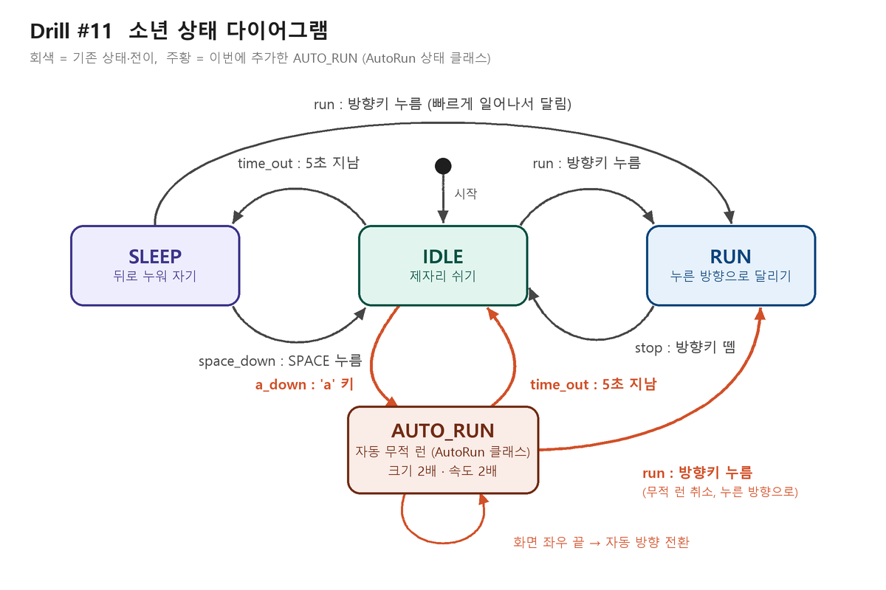

# DRILL 11 - 소년 자동 무적 런(AutoRun) 상태 추가

2D 게임 프로그래밍 (LEC12 캐릭터 컨트롤러) Drill #11

## 실행

```
pip install pico2d transitions
python main.py
```

| 키 | 동작 |
| --- | --- |
| ← / → | 누른 방향으로 달리기 (RUN), 떼면 멈춤 (IDLE) |
| a | IDLE 에서 자동 무적 런 (AUTO_RUN) 시작 |
| SPACE | 자는 소년 깨우기 (SLEEP → IDLE) |
| ESC / 창 닫기 | 종료 |

가만히 5초 두면 소년이 잠든다 (SLEEP). 자는 중에 방향키를 누르면 빠르게 일어나서 달린다.

## 상태 다이어그램



## 파일

| 파일 | 설명 |
| --- | --- |
| `main.py` | 게임 루프 (이벤트 → update → draw) |
| `boy.py` | 소년과 상태 머신. **`AutoRun` 상태 클래스**가 여기 있다 |
| `grass.py` | 땅 |
| `animation_sheet.png` | 소년 스프라이트 시트 (100x100 프레임 8개 x 4줄) |
| `grass.png` | 땅 이미지 |
| `test_boy.py` | 자동 테스트 16개 (`python test_boy.py`, 창 없이 실행) |
| `state_diagram.png` | 상태 다이어그램 |
| `PRD.md` | 개발 기획·요구사항 문서 |

`boys_team_10000.py`, `run_animation.png`, `ball*.png` 는 LEC12 수업 예제 파일로, 이 과제 실행에는 쓰지 않는다.

## 채점 기준과 구현

| 기준 | 구현 (`boy.py`) |
| --- | --- |
| 'a' 누르면 auto run 상태 이동 (1점) | `a_down` 전이(IDLE → AUTO_RUN). `Boy.handle_event` 가 `a` 키를 받아 발생시킨다. `AutoRun.do` 가 매 프레임 바라보는 방향으로 움직여 키 조작 없이 계속 달린다 |
| 5초 이상 경과하면 Idle 상태 복귀 (1점) | `AutoRun.enter` 에서 시작 시각을 기록하고, `AutoRun.do` 에서 5초(`AUTO_RUN_TIME`)가 지나면 `time_out` 전이(AUTO_RUN → IDLE) |
| 속도가 빨라지고, 크기가 커짐 (1점) | 속도 `AUTO_RUN_SPEED` = RUN 의 2배 (600 px/초). `AutoRun.enter` 에서 크기를 2배(`AUTO_RUN_SCALE`)로 키우고 `exit` 에서 되돌린다. `AutoRun.draw` 는 커진 그림의 발끝이 땅에 붙도록 위로 올려 그린다 |
| 좌우측 끝에서 자동 방향 전환 (1점) | `AutoRun.do` 에서 화면 끝(커진 몸 기준 여백 64px)에 닿으면 반대 방향으로 바꾼다 |
| 상태 다이어그램 (1점) | `state_diagram.png` |
| 방향키로 무적 런 취소 | `run` 전이의 출발 상태에 AUTO_RUN 포함. 누른 방향으로 원래 RUN 이 된다 |
| AutoRun 상태 클래스 (필수) | `class AutoRun(transitions.State)`: `enter`(entry action), `exit`(exit action), `do`(do activity), `draw`. `Boy` 는 `AutoRun('AUTO_RUN')` 객체를 상태 목록에 넣고 AUTO_RUN 동안 update/draw 를 맡긴다 |

## 개발 과정

LEC12 수업 실습(IDLE → SLEEP → RUN)의 커밋 기록을 그대로 가져와 이어서 개발했다.
`PRD.md` 의 단계대로 기능 하나마다 커밋했고, 단계마다 테스트로 확인했다.
